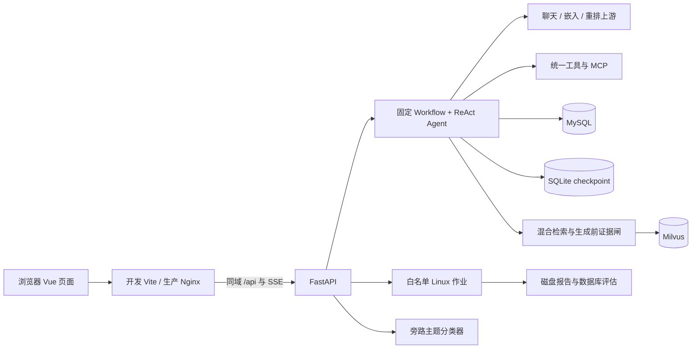

# SHAF 架构手册

本手册面向开发者与调试人员，说明当前源码职责和数据链路。项目使用 Vue 3 前端与 FastAPI 纯 API 后端；课程历史 spec/plan 是背景材料，发生差异时以源码、本阶段规划和用户确认的云端容器约定为准。

## 1. 系统边界

前端不读取数据库、不持有模型密钥、不直接调用 Milvus 或 MCP。生产页面和 API 可以在两个容器运行，Nginx 同域转发；本地仅做开发，真实服务在 Ubuntu 云端容器中运行。前端不把缺产物或取数失败伪装成零分。

## 2. 核心在线链路

### 2.1 会话与图编排

用户稳定身份与会话选择由浏览器保存；`mewhelp_session_id` / `mewhelp_conversation_id` 保留兼容。MySQL 保存业务会话、消息、反馈与审计；SQLite 保存 LangGraph 线程及中断状态，二者不能互相替代。浏览器来源变更（例如 8000 切到 5173）时 localStorage 不共享，开发时会建立新的本地选择。

主流程先消解指代，再识别九类意图，并按固定规则进入知识问答、退款、业务 Agent、投诉或闲聊兜底。知识问答强制检索；退款先定位属于该用户的订单，必要时中断让用户选单，然后查退款政策。ReAct Agent 在既定路径内组合工具，最多十步，最后统一记录。

历史上下文分近期原文、较早消息压缩与追加摘要段三层。模型窗口预算决定可携带历史；system 与工具 schema 前缀保持稳定，回合上下文按规定位置注入。异步摘要不直接等同于图 checkpoint。

### 2.2 SSE 与人工确认

聊天和续跑使用 POST fetch 流。前端处理增量、工具、引用、建议动作、中断和完成事件，兼容 UTF-8/CRLF 分块，意外断流显示错误。切会话或卸载会取消请求，并隔离迟到结果。

只读工具允许受控重试；写工具不自动重试。建工单可触发用户确认中断，取消明确传 `confirmed=false`。退款工具的建议转为用户表单，订单号只读，用户选择固定退款原因后才通过 actions API 写入。人工转接仍是教程的模拟交互，订单及物流仍保留原 mock 实现。

### 2.3 RAG 与知识写回

Milvus Standalone 提供 dense 与中文 BM25，两路召回经 RRF、多子句合并和重排，形成可引用证据。生成前同时检查机械证据置信度与语义自检，证据不足则拒答并落入问题池。

MySQL 是知识记录主源，向量写回失败时保留 pending 等待重试。待审/飞轮核准的失败回滚只处理本次新增记录，并保留人工审核状态；不可一概删除历史知识。候选挖掘、标准化去重与人工核准属于离线/后台链路。

### 2.4 观测、报告与分类

Langfuse 提供 trace 与意图成本，评估表提供趋势，磁盘 JSON 提供 RAG、校准和分类验收产物。页面展示同一权威报告，不另算评测分数。RAG 裁判判出率与人工确认幻觉率均按本轮可用题量计，累计台账只用于跨轮追踪，不能拿累计条数除以本轮题量。

在线九类意图用于客服路由；旁路 17 类多标签主题用于知识缺口排序，两者不能替换。训练/评估与 ONNX 轻推理分工，阈值和 tokenizer 都是模型产物的一部分。单句实验分数由分类器返回，前端只绘图。

## 3. 前端组织与页面

视图组织页面，组件承载聊天卡片、表单、报表与图表，composables 管理会话、取数和作业生命周期。共享 JSON/SSE 客户端处理错误与取消，types 明确契约。新代码统一 `<script setup lang="ts">`，使用格式化工具保持可读。

| URL | 职能 |
|---|---|
| `/` | 聊天、历史、引用、反馈、订单选择、工单/退款表单与确认续跑 |
| `/admin` | 后台六模块聚合入口 |
| `/kb` | 知识盘点、预览、入库、向量化、检索及挖掘待审 |
| `/review` | 飞轮待审详情、召回快照、人工核准和驳回 |
| `/rag-eval` | 四策略对照、生成评估与编造台账处置 |
| `/observability` | 意图成本、评估趋势与置信度校准 |
| `/topics` | 17 类主题分布 |
| `/topics/questions` | 类目问题与服务端分页 |
| `/acceptance` | 分类器九项验收 |
| `/acceptance/eval` | 分类指标、红线、扫描、矩阵与单句实验 |
| `/acceptance/data` | 数据血缘、泄漏、训练与 ONNX 产物 |
| `/acceptance/errors` | 分类错例与边界配对 |

## 4. 开发与维护入口

- 修改页面交互：先查看对应 view、子组件、composable 和 API schema；不要在前端重写业务规则。
- 修改路由/工具：查看 graph build/routing/nodes、工具 registry/engine 与审计边界；写操作必须保留确认和归属校验。
- 修改检索/知识：查看 core retrieval/confidence/selfcheck 与 kb dualwrite，保留失败状态和可重试口径。
- 调试页面：检查网络中的 `/api` 响应、SSE 帧与错误提示；Vite 代理和 Nginx 代理地址处在不同运行环境。
- 调试任务：查看后端返回日志；make 白名单没有消除数据库、模型、平台和计算资源的前置条件。
- 扩展文件：同时更新下方逐文件清单，再执行 `python scripts/check_architecture.py`。

开发启动见 README；容器配置与尚需完成的服务编排见 DEPLOY。当前进程内图与作业状态采用单 worker。不要在此次前端改造中擅自改变历史数据库、卷名和业务语义。

## 5. 正式项目文件清单（100%）

覆盖集合为当前 Git 跟踪文件加未忽略的新项目文件，过滤已删除文件；每个文件只出现一次。校验脚本同时发现遗漏、重复和过期条目。第三方依赖内部文件、密钥及运行数据不属于正式源码全集，见第 6 节。

### 5.1 根配置与部署

| 文件 | 职责与维护提示 |
|---|---|
| `.dockerignore` | 后端构建上下文排除密钥、Git、本地环境、前端与运行数据。 |
| `.env.example` | 后端配置模板：模型、数据库、MCP、分类器、预算、CORS 和观测配置；仅含占位值。 |
| `.gitattributes` | 统一文本换行与编码行为，降低跨 Windows / Ubuntu 协作差异。 |
| `.gitignore` | 排除密钥、简介原稿、虚拟环境、依赖、日志、checkpoint 和训练产物。 |
| `DEPLOY.md` | 当前分离架构的容器边界、配置、持久化、启动与尚需云端验收的前置。 |
| `Dockerfile.backend` | Python/uv 后端镜像，保留 Linux 作业工具，单 worker 启动 FastAPI。 |
| `Makefile` | 离线与服务管理目标；页面作业复用其中的白名单目标，依赖 Ubuntu/POSIX。 |
| `README.md` | 项目定位、技术栈、本地开发入口、课程能力与导航。 |
| `docker-compose.app.yml` | Vue/Nginx 与 FastAPI 两个应用容器；与原基础设施配置合并使用。 |
| `docker-compose.langfuse.yml` | 独立 Langfuse web/worker、Postgres、ClickHouse、Redis 与对象存储栈。 |
| `docker-compose.yml` | MySQL、Milvus Standalone、etcd、MinIO 及原命名的数据卷、初始化 SQL。 |
| `pyproject.toml` | Python 依赖、Python 版本、dev/ml 分组和 pytest 配置；包元数据旧名保留兼容。 |
| `uv.lock` | 精确锁定 Python 依赖解析结果，用于可重复同步。 |

### 5.2 后端 HTTP 与配置

| 文件 | 职责与维护提示 |
|---|---|
| `app/__init__.py` | Python 包标记，无独立业务逻辑。 |
| `app/api/__init__.py` | Python 包标记，无独立业务逻辑。 |
| `app/api/acceptance.py` | 分类器九项验收、语料/模型产物、评测/扫描/错例与在线试分类。 |
| `app/api/actions.py` | 用户明确提交的建工单、退款与中断续跑；校验会话和订单归属。 |
| `app/api/admin.py` | 六模块后台卡片聚合，把各模块健康、待办和缺产物状态归一。 |
| `app/api/agent.py` | 非流式 Agent 入口，返回答案、工具轨迹及建议动作，复用图运行时。 |
| `app/api/chat.py` | 用户会话流式聊天入口，处理 graph 事件、引用、操作卡、中断与 SSE 错误。 |
| `app/api/conversations.py` | 会话列表、历史消息与会话定位，供聊天侧栏和恢复使用。 |
| `app/api/extract.py` | 结构化信息提取教学接口，使用提取 schema 和模型客户端。 |
| `app/api/feedback.py` | 消息反馈落库；无帮助反馈进入待补知识问题池。 |
| `app/api/jobs.py` | 白名单作业发起、查询日志与停止入口，不接受任意命令。 |
| `app/api/kb.py` | 知识概览、切块预览、手工入库、向量化、检索与挖掘待审操作。 |
| `app/api/observability.py` | 分别聚合磁盘成本/校准报告与数据库评估趋势，依赖失败按块隔离。 |
| `app/api/rageval.py` | 读取 RAG 报告、跨轮编造台账与处置；计算权威本轮幻觉率口径。 |
| `app/api/review.py` | 飞轮队列详情、人工答案核准及驳回；核准后双写知识库。 |
| `app/api/topics.py` | 旁路主题分类的 17 类分布与类目问题服务端分页。 |
| `app/config.py` | 集中读取后端环境配置与调优常量；实例化时校验必填模型参数。 |
| `app/main.py` | 纯 API 应用、路由注册、CORS、日志、Milvus 预热、图生命周期与存活检查。 |
| `app/schemas/__init__.py` | Python 包标记，无独立业务逻辑。 |
| `app/schemas/actions.py` | 人工工单、退款和确认续跑请求的字段及合法值约束。 |
| `app/schemas/agent.py` | 非流式 Agent 请求、响应及工具调用结果结构。 |
| `app/schemas/chat.py` | 流式聊天请求与用户/会话标识字段约束。 |
| `app/schemas/extract.py` | 结构化提取输入与目标字段模型。 |
| `app/schemas/feedback.py` | 回答反馈请求、消息定位及满意度约束。 |
| `app/schemas/rageval.py` | 编造个案处置状态和说明长度约束。 |
| `app/schemas/review.py` | 人工审核核准答案请求模型。 |

### 5.3 核心能力与图编排

| 文件 | 职责与维护提示 |
|---|---|
| `app/core/__init__.py` | Python 包标记，无独立业务逻辑。 |
| `app/core/budget.py` | 根据模型窗口和最坏单轮成本估算可用历史预算，支持启动自检。 |
| `app/core/confidence.py` | 以最高重排分、有效块数、分差和关键条款计算证据置信度。 |
| `app/core/coref.py` | 结合上下文消解指代，给后续分类与检索完整问句。 |
| `app/core/embeddings.py` | 嵌入上游调用、批处理和向量维度约定。 |
| `app/core/flywheel.py` | 问题标准化、过滤与归并，形成可人工审核的知识缺口。 |
| `app/core/intent.py` | 九类在线客服意图识别；与旁路 17 类主题体系职责不同。 |
| `app/core/jobs.py` | make 白名单、单任务状态、日志尾部和 POSIX 进程组停止。 |
| `app/core/llm.py` | 统一聊天、结构化与工具调用上游适配、流事件和用量统计。 |
| `app/core/memory.py` | 会话三层上下文与近期滑窗、历史压缩、摘要段注入。 |
| `app/core/model_guard.py` | 模型本地规格、上下文与配置合法性检查。 |
| `app/core/observability.py` | Langfuse 接入及 trace/用量上下文，未配置时允许框架继续运行。 |
| `app/core/prompts.py` | 各课程与运行链路提示词模板，包含在线 Agent、分类、自检及总结约束。 |
| `app/core/query_understanding.py` | 检索查询改写与多子句拆分，保留型号等硬关键词。 |
| `app/core/read_notes.py` | 生成并校验报表读图注，避免说明文本引入不存在的数字。 |
| `app/core/rerank.py` | 重排上游请求与精排结果加工。 |
| `app/core/retrieval.py` | dense/BM25 双路召回、RRF 融合、多子句合并与重排。 |
| `app/core/selfcheck.py` | 生成前语义证据自评；异常时不放行无据回答。 |
| `app/core/summarizer.py` | 异步生成和追加摘要段，管理摘要覆盖边界。 |
| `app/core/taxonomy.py` | 17 个权威主题名称与严/中/宽档，供训练、API 和报告共用。 |
| `app/graph/__init__.py` | Python 包标记，无独立业务逻辑。 |
| `app/graph/build.py` | 组装固定 Workflow、主 Agent 和 tools 循环的 LangGraph 图。 |
| `app/graph/nodes.py` | 指代、分类、订单中断、RAG、自检、Agent、固定回复及消息记录节点。 |
| `app/graph/routing.py` | 意图、Agent 工具调用、步数和分支路由的确定性规则。 |
| `app/graph/runtime.py` | 图实例、SQLite checkpointer、会话 thread 和 invoke/stream/resume 生命周期。 |
| `app/graph/state.py` | 跨节点 AgentState 字段与消息合并规则。 |

### 5.4 数据、知识与工具

| 文件 | 职责与维护提示 |
|---|---|
| `app/db/__init__.py` | Python 包标记，无独立业务逻辑。 |
| `app/db/base.py` | SQLAlchemy 异步 engine、session 工厂与 Base。 |
| `app/db/models.py` | 会话、消息、知识、问题池、审核、评估、主题与工具审计表模型。 |
| `app/db/repository.py` | 数据库读写与分页/归并等持久化操作，供图节点和 API 调用。 |
| `app/kb/__init__.py` | Python 包标记，无独立业务逻辑。 |
| `app/kb/chunking.py` | 不同文档类型的标题、段落和表格切块、重叠及块元数据。 |
| `app/kb/dedup.py` | 候选问答与既有知识的重复检测。 |
| `app/kb/documents.py` | 知识源文件读取与文档表示。 |
| `app/kb/dualwrite.py` | MySQL 主记录与 Milvus 向量双写、pending 重试及审核失败回滚边界。 |
| `app/kb/milvus_client.py` | Milvus schema、dense/BM25 索引、检索与 upsert/delete 接口。 |
| `app/kb/mining.py` | 从历史对话挖掘候选知识，过滤后进入待审区。 |
| `app/kb/sources.py` | 知识源目录、内容类型与文件盘点定义。 |
| `app/tools/__init__.py` | Python 包标记，无独立业务逻辑。 |
| `app/tools/builtin/__init__.py` | Python 包标记，无独立业务逻辑。 |
| `app/tools/builtin/faq.py` | 将知识查询注册为可用工具，走项目 RAG。 |
| `app/tools/builtin/orders.py` | 订单、物流与用户订单列表工具，保留归属边界。 |
| `app/tools/builtin/refunds.py` | 退款工具入口与前端确认表单拦截约定。 |
| `app/tools/builtin/tickets.py` | 建工单写工具，进入统一执行和确认流程。 |
| `app/tools/business.py` | 业务函数：订单/物流 mock、FAQ 查询及工单/退款数据写入。 |
| `app/tools/engine.py` | 统一执行、超时、只读重试、写操作确认与审计。 |
| `app/tools/mcp_client.py` | 外部 MCP 发现、HTTP 调用、业务码转换和工具结果裁剪。 |
| `app/tools/registry.py` | 内置注册与 MCP 工具统一目录、schema 和扫描。 |
| `mcp_servers/__init__.py` | Python 包标记，无独立业务逻辑。 |
| `mcp_servers/aftersales_server.py` | 售后 MCP 服务：提供退款/售后能力与外部工具 schema。 |
| `mcp_servers/logistics_server.py` | 物流 MCP 服务：提供原始业务状态，客户端负责转译。 |

### 5.5 前端构建与源码

| 文件 | 职责与维护提示 |
|---|---|
| `frontend/.dockerignore` | 前端镜像排除本地依赖、构建产物、测试报告和环境变量。 |
| `frontend/.env.example` | Vite 开发代理地址模板，无浏览器业务密钥。 |
| `frontend/.prettierrc.json` | Vue/TypeScript/CSS 的统一格式化规则。 |
| `frontend/Dockerfile` | Node 构建阶段与 Nginx 静态运行阶段。 |
| `frontend/index.html` | 唯一 Vue HTML 入口，挂载根节点与模块脚本。 |
| `frontend/nginx.conf` | 保留 /api 路径、关闭 SSE 缓冲、SPA 回退及静态缓存。 |
| `frontend/package-lock.json` | npm 精确锁文件，生产构建使用 npm ci。 |
| `frontend/package.json` | 前端依赖与开发、构建、单元、浏览器、格式化脚本。 |
| `frontend/playwright.config.ts` | 受控 API 浏览器回归、Vite 启动和当前本机 Edge 渠道。 |
| `frontend/src/App.vue` | 应用外壳：每个页面负责自身数据生命周期，路由切换卸载旧页面。 |
| `frontend/src/api/http.ts` | JSON 请求边界：统一错误信息、取消信号与查询参数，不向浏览器提供后端密钥。 |
| `frontend/src/api/sse.ts` | POST SSE 协议：跨字节解码、逐帧分发、显式结束及取消；不把断流当成成功。 |
| `frontend/src/components/admin/AdminNav.vue` | 后台统一导航：保持旧 URL 与模块分组，分类器子页显示第二层导航。 |
| `frontend/src/components/admin/AdminShell.vue` | 后台页面外壳：共享标题、导航、加载/错误提示，保留各页面的内容布局。 |
| `frontend/src/components/admin/ChunkPreview.vue` | 切块预览：展示与后端相同的块、查重及切分特性，不在浏览器重复切块。 |
| `frontend/src/components/admin/ClassifierTry.vue` | 单句分类实验：后端返回阈值、标签和独立分数；卸载取消请求，禁止重复提交。 |
| `frontend/src/components/admin/FaithCaseCard.vue` | 编造个案卡片：答案与完整证据快照、引用标记以及必须留说明的状态处置。 |
| `frontend/src/components/admin/FaithLedger.vue` | 跨轮编造台账：独立取数和分页，本轮幻觉率与累计台账明确分开。 |
| `frontend/src/components/admin/FileTable.vue` | 产物文件清单：保留路径、存在性、条数、大小和写入时间的统一显示口径。 |
| `frontend/src/components/admin/JobButton.vue` | 白名单作业按钮与日志：各后台页面复用，卸载时结束轮询。 |
| `frontend/src/components/admin/JobRow.vue` | 一组作业入口：只负责分组，具体运行状态和日志由各 JobButton 持有。 |
| `frontend/src/components/admin/KpiRow.vue` | 报表关键数卡片：只格式化调用方传入的权威值，不设隐含的通过线。 |
| `frontend/src/components/admin/LineChart.vue` | 响应式 SVG 折线图：只把报告中的点映射到坐标，标记推荐线和在用线。 |
| `frontend/src/components/admin/Paginator.vue` | 服务端分页控件：使用响应中的裁剪页码，上一页/下一页不在客户端筛选数据。 |
| `frontend/src/components/admin/RagChart.vue` | 四策略分组柱图：统一桶、色彩与 0~1 坐标；缺值以淡条和 — 表示。 |
| `frontend/src/components/admin/RagGeneration.vue` | RAG 生成评估：答案覆盖度、分桶忠实度、拒答圆环和该拒没拒个案。 |
| `frontend/src/components/admin/ReadNote.vue` | 读图说明：产物注优先，缺失时使用页面说明；数字以文本片段加粗，拒绝 HTML 注入。 |
| `frontend/src/components/admin/RetrievalHits.vue` | 检索结果卡片：保留原始分与重排分、原文及章节来源，不计算新指标。 |
| `frontend/src/components/admin/ReviewCard.vue` | 审核缺口卡片：独立懒加载详情；区分无检索、零命中、有召回三种证据状态。 |
| `frontend/src/components/admin/ScoreCell.vue` | 指标单元格：数值加横条，仅在有明确红线时显示达标颜色。 |
| `frontend/src/components/chat/ActionForm.vue` | 用户确认的写操作表单：工单手填、退款固定原因；失败保留输入，成功才禁用入口。 |
| `frontend/src/components/chat/CatAvatar.vue` | 原页面像素猫图标：用 SVG 组件复用，不在运行时拼接 HTML。 |
| `frontend/src/components/chat/ChatMessageItem.vue` | 单条消息：工具标记、引用、反馈、建议动作与两类暂停卡片。 |
| `frontend/src/components/chat/MessageContent.vue` | Markdown 与引用渲染：先消毒，再装饰文本节点；引用浮层只显示 Vue 转义文本。 |
| `frontend/src/composables/useChat.ts` | 会话状态机：发送、续跑、历史隔离与用户反馈；所有请求随页面卸载取消。 |
| `frontend/src/composables/useJob.ts` | 单个任务生命周期：串行轮询、重任务确认、停止与卸载取消，完成状态独立于页面刷新。 |
| `frontend/src/composables/useResource.ts` | 页面取数状态：最后一次请求生效；卸载取消，避免旧响应覆盖新筛选条件。 |
| `frontend/src/main.ts` | 应用启动：全局样式与路由仅初始化一次。 |
| `frontend/src/router.ts` | 页面路由：保留旧系统所有业务 URL，后台子页按需加载。 |
| `frontend/src/styles/admin.css` | 后台共享视觉规范：沿用原页面配色、卡片、表格与硬阴影。 |
| `frontend/src/styles/chat.css` | 聊天视觉规范：保留旧页面的像素猫、会话侧栏、气泡及表单布局。 |
| `frontend/src/styles/theme.css` | 全站设计变量与基础重置：聊天浮层和后台组件共享同一配色。 |
| `frontend/src/types/acceptance.ts` | 分类器验收契约：只展示后端读取的真实报告，缺产物通过 present 显式区分。 |
| `frontend/src/types/chat.ts` | 聊天视图契约：与后端 SSE、动作接口及历史消息的实际字段一致。 |
| `frontend/src/types/jobs.ts` | 后台作业契约：命令、前置条件与状态全部由后端白名单提供。 |
| `frontend/src/types/kb.ts` | 知识库页面数据契约：MySQL 权威原文、Milvus 状态、切块与人工暂存审核。 |
| `frontend/src/types/observability.ts` | 观测报表契约：三块分别来自磁盘、评估表和校准产物，互不连坐。 |
| `frontend/src/types/ragEval.ts` | RAG 报告与跨轮台账契约；未知指标保持 null，不折算为零分。 |
| `frontend/src/types/review.ts` | 飞轮审核契约：队列行、归并原话与当时检索快照。 |
| `frontend/src/types/topics.ts` | 旁路分类结果契约：多标签计入每个类目，问题原话与标准化问句同时保留。 |
| `frontend/src/utils/format.ts` | 页面格式化：缺失值保留未知语义，禁止把尚未产生的指标显示成零。 |
| `frontend/src/views/AcceptanceDataView.vue` | 分类器数据血缘：语料流转、切分泄漏、训练三件套及 ONNX 一致性证据。 |
| `frontend/src/views/AcceptanceErrorsView.vue` | 分类器错例复核：区分样本条数和矩阵笔数，展示边界配对与逐条标签差异。 |
| `frontend/src/views/AcceptanceEvalView.vue` | 分类器评测详情：总分、每类红线、阈值扫描、混淆矩阵及单句试分类。 |
| `frontend/src/views/AcceptanceView.vue` | 分类器验收总览：九项证据、服务状态及白名单作业入口。 |
| `frontend/src/views/AdminView.vue` | 后台聚合首页：显示各模块 API 提供的状态、结论和入口，不重复计算业务指标。 |
| `frontend/src/views/ChatView.vue` | 聊天页：保持原 UI，视图只分发用户操作，网络与会话状态由 useChat 管理。 |
| `frontend/src/views/KnowledgeView.vue` | 知识库录入页：六个原有业务区，使用后端统一切块、双写与人工审核接口。 |
| `frontend/src/views/ObservabilityView.vue` | 观测与成本：保留三块报表、读图说明、阈值扫描及各自的作业重跑入口。 |
| `frontend/src/views/RagEvalView.vue` | RAG 评估入口：只读四策略报告，组织图表、生成评估、跨轮台账和重跑作业。 |
| `frontend/src/views/ReviewView.vue` | 飞轮待审页：筛选、查看召回现场、核准答案写回与驳回，保留失败后的编辑内容。 |
| `frontend/src/views/TopicQuestionsView.vue` | 类目问题列表：类目/页码保存在路由，参数变化自动取数并取消旧请求。 |
| `frontend/src/views/TopicsView.vue` | 主题分布：按问题量排序，展开三条样例；类目链接进入服务端分页列表。 |
| `frontend/tsconfig.json` | 严格 TypeScript、DOM、模块解析与源码/测试配置。 |
| `frontend/vite.config.ts` | Vue 编译、开发 /api 代理与 Vitest 环境。 |

### 5.6 离线与辅助脚本

| 文件 | 职责与维护提示 |
|---|---|
| `scripts/__init__.py` | Python 包标记，无独立业务逻辑。 |
| `scripts/bare_agent_loop.py` | 祛魅:不用任何框架,手写最裸的 Agent 循环——看清它就是个带工具清单的 for 循环。 |
| `scripts/build_kb.py` | CLI:把 data/kb/*.md 切块写入 knowledge_chunks(pending)。之后跑 vectorize_kb.py。 |
| `scripts/calibrate_confidence.py` | ch09 证据置信度阈值校准脚本：用 ch04 评估集为 evidence_confidence_threshold 找数据分离点。 |
| `scripts/ch10/__init__.py` | Python 包标记，无独立业务逻辑。 |
| `scripts/ch10/build_corpus.py` | ch10 语料流水线:捞池 → 脱敏去重 → LLM 修错别字 → LLM 预标 → 模拟补足 → 导出人工抽审。 |
| `scripts/ch10/build_dataset.py` | ch10 数据集:分层划分 80/10/10 + 训练集增强(同义词替换/句式微调)。 |
| `scripts/ch10/classify_pool.py` | ch10 旁路批处理:低置信度问题攒够一批,整批喂分类器归一次类,结果写 topic_classifications。 |
| `scripts/ch10/corpus_lib.py` | ch10 数据流水线纯函数:脱敏、去重、分层划分。不碰网络与 DB,可单测。 |
| `scripts/ch10/evaluate.py` | ch10 评测:留出测试集上每类 P/R/F1 + 每类混淆矩阵 + 容错红线 + 判错样本导出。 |
| `scripts/ch10/export_onnx.py` | ch10 ONNX 导出:torch 模型 → onnx(变长 batch/seq),导出后跑测试集校验与 torch 预测完全一致。 |
| `scripts/ch10/golden_samples.jsonl` | 分类预标提示词黄金样例，批量预标前验证使用。 |
| `scripts/ch10/inference_lib.py` | ch10 推理纯函数:阈值应用与空标签兜底。evaluate 与 serve 共用,行为不许分叉。 |
| `scripts/ch10/prelabel.py` | ch10 预标:大模型照权威术语表给问题打多标签。折中路线的前半——预标,后半人工抽审。 |
| `scripts/ch10/scan_threshold_replay.py` | 验证集通过 ONNX 服务打分一次，固定分数表重演九个候选阈值并写扫描报告。 |
| `scripts/ch10/serve.py` | ch10 推理服务:ONNX + FastAPI 独立进程 :8110,轻运行时(onnxruntime + tokenizers,不背 torch)。 |
| `scripts/ch10/supplement_sizefit.jsonl` | 尺码适配定向补充训练语料，不用于修改测试考卷。 |
| `scripts/ch10/train.py` | ch10 训练:RoBERTa-wwm-ext 全参微调,17 类多标签(BCEWithLogitsLoss)。 |
| `scripts/ch10/validate_golden.py` | ch10 预标质量闸:黄金样例上标签集合完全一致率 ≥ 80% 才放行批量预标。 |
| `scripts/check_architecture.py` | 校验手册逐文件清单的 100% 覆盖、重复和过期路径。 |
| `scripts/cost_by_intent.py` | ch09 Cost Control：从 Langfuse 按意图汇总近 N 天的 token 消耗，定位最耗资源的业务意图。 |
| `scripts/demo_agent.sh` | 非流式 Agent 调用演示，展示工具调用返回。 |
| `scripts/demo_ch08_promotions.py.txt` | 工具扩展示例文本，不被运行时自动扫描；用于人工参考。 |
| `scripts/demo_chat.sh` | 原纯聊天接口演示脚本；课程遗留会话参数需结合当前 schema 使用。 |
| `scripts/dev.sh` | 教程本机多进程启动和依赖预检；当前约定下不作为云部署入口。 |
| `scripts/eval_agent.py` | 标注样例评估:核对 glm-5.2 是否按预期选中工具,并观察 query_faq 的关键词与漏召回。 |
| `scripts/eval_ch04.py` | 四策略(vector/bm25/hybrid/hybrid_rerank)分桶评估。需 Milvus Standalone + 已建库 + 上游可调通。 |
| `scripts/eval_ch05.py` | ch05 五验收端到端评估。需全服务起(mysql/milvus/上游/app 新代码)。 |
| `scripts/eval_ch06.py` | ch06 四验收端到端评估。需全服务起(mysql/milvus/上游/app)+ 已应用 sql/ch06-ticket-type.sql。 |
| `scripts/eval_ch07.py` | ch07 摘要 prompt 标注样例验证(纯 Prompt 任务以 eval 代 TDD)。需聊天上游可调通。 |
| `scripts/eval_ch08.py` | ch08 验收样例端到端评估:建工单确认流(追问/预览/确认/取消)+ 物流走 MCP。 |
| `scripts/eval_coref.py` | 指代消解标注评估:多轮带指代补全 + 已完整透传。需聊天上游可调通。 |
| `scripts/eval_expand.py` | Query 扩写标注评估:核心场景出 3 条 + JSON 稳定 + 保持关键实体。需聊天上游可调通。 |
| `scripts/eval_extract.py` | 对 /api/extract 跑标注样例,核对 order_id 与 request_type(expected_solution 人工目检)。 |
| `scripts/eval_flywheel.py` | ch09 自动化评估流水线:复用 ch04 评估集与指标,定期跑、落 eval_runs、连趋势。 |
| `scripts/eval_intent.py` | 意图四件套标注评估:九类判对率(ch08 增「人工」)+ confidence 可解析 + 怪问题落其他 + 多轮漂移。需聊天上游可调通。 |
| `scripts/eval_mining.py` | 挖知识 eval:对样例对话跑抽取,核对该抽的抽到、不该抽的(纯个案)不硬抽。 |
| `scripts/eval_retrieval.py` | 验收1 eval:对换说法的问题跑向量检索,核对是否召回期望内容(纯测向量召回,不掺 LLM)。 |
| `scripts/flywheel_pipeline.py` | ch09 飞轮批处理:扫问题池未归并条目 → 标准化+查重 → 待审队列。 |
| `scripts/judge_check.py` | 裁判回归:拿人工处置过的编造个案台账,反过来考忠实度裁判。 |
| `scripts/kb_repatch.py` | 改完 data/kb/*.md 之后,只把改动的那几块重新入库(不整库重建)。 |
| `scripts/mine_knowledge.py` | 调用挖知识流程：历史对话抽取、暂存与去重保留，等待人工审核后才写知识库。 |
| `scripts/show_kb.py` | 验收展示(dry-run):列出建库材料 + 预览结构化切块结果,不写库、不碰 Milvus、不调上游。 |
| `scripts/smoke_embed.py` | 冒烟:直连 SiliconFlow 调 BGE-M3,验证连通与维度。 |
| `scripts/smoke_interrupt.py` | ch06 interrupt / Command(resume) 红线冒烟脚本。 |
| `scripts/smoke_langgraph.py` | ch05 红线冒烟:StateGraph + AsyncSqliteSaver + 多模式流式 是否在当前版本跑通,并打印流式形状。 |
| `scripts/smoke_milvus_bm25.py` | Milvus Standalone 原生 BM25 全文检索 + hybrid_search 冒烟。不通即红线停。 |
| `scripts/smoke_rerank.py` | 直连 SiliconFlow /rerank 冒烟。不通即红线停。 |
| `scripts/smoke_toolcall.py` | 真实验证 glm-5.2 直连上游能否返回结构化 tool_calls。go/no-go 风险闸。 |
| `scripts/validate_eval_ch04.py` | 评估集自检(ch04):300 题手写的 ground truth 靠这个脚本兜住,不靠人眼。 |
| `scripts/validate_flywheel_samples.py` | ch09 Prompt 标注样例验证(工作要求:纯 Prompt 任务拿标注样例跑一遍代替 TDD)。 |
| `scripts/vectorize_kb.py` | CLI:把 knowledge_chunks 里 pending 的块向量化写入 Milvus(幂等可重跑)。 |

### 5.7 SQL、知识与报告

| 文件 | 职责与维护提示 |
|---|---|
| `data/ch04/reports/rag_eval.json` | 四策略分桶检索、证据覆盖、生成质量及裁判个案评估产物。JSON 供 API 读取。 |
| `data/ch04/reports/rag_eval.txt` | 四策略分桶检索、证据覆盖、生成质量及裁判个案评估产物。供人工查看；不是第二套计算口径。 |
| `data/ch09/reports/confidence_calibration.json` | 证据置信度分布、阈值扫描与推荐值产物。JSON 供 API 读取。 |
| `data/ch09/reports/confidence_calibration.txt` | 证据置信度分布、阈值扫描与推荐值产物。供人工查看；不是第二套计算口径。 |
| `data/ch09/reports/cost_by_intent.json` | Langfuse 按意图归集的 token 成本产物。JSON 供 API 读取。 |
| `data/ch09/reports/cost_by_intent.txt` | Langfuse 按意图归集的 token 成本产物。供人工查看；不是第二套计算口径。 |
| `data/ch09/reports/eval_trend.txt` | 评估趋势的可读摘要产物。供人工查看；不是第二套计算口径。 |
| `data/ch09/reports/eval_trend_note.json` | 绑定最近评估轮次的读图注产物。JSON 供 API 读取。 |
| `data/ch10/reports/classify_run.json` | 旁路归类执行状态与写入计数产物。JSON 供 API 读取。 |
| `data/ch10/reports/error_samples.md` | 分类错例的人类可读清单。供人工查看；不是第二套计算口径。 |
| `data/ch10/reports/eval_report.json` | 分类器 P/R/F1、红线、混淆矩阵与错例评估产物。JSON 供 API 读取。 |
| `data/ch10/reports/eval_report.md` | 分类器 P/R/F1、红线、混淆矩阵与错例评估产物。供人工查看；不是第二套计算口径。 |
| `data/ch10/reports/export_report.json` | ONNX 导出与 torch 标签一致性校验产物。JSON 供 API 读取。 |
| `data/ch10/reports/golden_report.json` | 预标黄金样例通过率产物。JSON 供 API 读取。 |
| `data/ch10/reports/threshold_scan.json` | 固定验证集分数上的候选阈值扫描产物。JSON 供 API 读取。 |
| `data/kb/after-sales-manual.md` | 售后处理、工单和维修知识源。教学文本可能含冲突条款，保留原内容以检验检索与关键条款处理。 |
| `data/kb/billing-shipping.md` | 发票、配送与运费知识源。教学文本可能含冲突条款，保留原内容以检验检索与关键条款处理。 |
| `data/kb/member-benefits.md` | 会员权益与积分知识源。教学文本可能含冲突条款，保留原内容以检验检索与关键条款处理。 |
| `data/kb/product-faq.md` | 商品常见问答知识源。教学文本可能含冲突条款，保留原内容以检验检索与关键条款处理。 |
| `data/kb/product-specs.md` | 商品型号、参数和适配知识源。教学文本可能含冲突条款，保留原内容以检验检索与关键条款处理。 |
| `data/kb/returns-policy.md` | 退换货规则与关键条款知识源。教学文本可能含冲突条款，保留原内容以检验检索与关键条款处理。 |
| `sql/ch02-ddl.sql` | FAQ、会话、消息、工单等初始业务表。已有数据库需按实际版本迁移，不能假设首次初始化再次执行。 |
| `sql/ch02-seed.sql` | 幂等灌入 FAQ 演示知识。已有数据库需按实际版本迁移，不能假设首次初始化再次执行。 |
| `sql/ch03-ddl.sql` | 知识块与问答挖掘暂存区表。已有数据库需按实际版本迁移，不能假设首次初始化再次执行。 |
| `sql/ch03-seed.sql` | 合成历史对话种子；幂等清理并重灌 seed-% 会话。已有数据库需按实际版本迁移，不能假设首次初始化再次执行。 |
| `sql/ch03-staging-review.sql` | 挖知识暂存区增加 approved/rejected 终态，并按时间界限迁移旧 kept 状态。已有数据库需按实际版本迁移，不能假设首次初始化再次执行。 |
| `sql/ch04-ddl.sql` | 创建低置信度问题池与跨轮编造个案台账。已有数据库需按实际版本迁移，不能假设首次初始化再次执行。 |
| `sql/ch06-ticket-type.sql` | 工单类别演进迁移。已有数据库需按实际版本迁移，不能假设首次初始化再次执行。 |
| `sql/ch07-ddl.sql` | 会话摘要及上下文覆盖边界迁移。已有数据库需按实际版本迁移，不能假设首次初始化再次执行。 |
| `sql/ch07-layers.sql` | 增加会话层1边界与追加式分段摘要表。已有数据库需按实际版本迁移，不能假设首次初始化再次执行。 |
| `sql/ch08-ddl.sql` | 统一工具调用审计表。已有数据库需按实际版本迁移，不能假设首次初始化再次执行。 |
| `sql/ch09-ddl.sql` | 创建飞轮待审/评估轮次表，给问题池增加召回快照与归并外键。已有数据库需按实际版本迁移，不能假设首次初始化再次执行。 |
| `sql/ch10-ddl.sql` | 旁路主题分类结果表。已有数据库需按实际版本迁移，不能假设首次初始化再次执行。 |

### 5.8 Python 与浏览器测试

| 文件 | 职责与维护提示 |
|---|---|
| `frontend/tests/e2e/admin-pages.spec.ts` | 后台路由回归：所有迁移页面可独立加载，验证报告缺失、旁路翻页和台账写回失败重试。 |
| `frontend/tests/e2e/chat-knowledge.spec.ts` | 受控浏览器交互：流式聊天及知识输入失效，不宣称真实基础设施联调。 |
| `frontend/tests/e2e/refund.spec.ts` | 退款安全交互回归：选单续跑、订单只读、原因人工选择、写入失败后保留输入。 |
| `frontend/tests/e2e/report-artifacts.spec.ts` | 已有真实报告展示回归：使用仓库产物，不启动 Milvus、模型或训练服务。 |
| `frontend/tests/e2e/review.spec.ts` | 飞轮审核浏览器回归：写回失败保留人工答案，成功后显示新队列状态。 |
| `frontend/tests/unit/chat.test.ts` | 会话回归：取消后旧响应隔离、明确取消工单，以及历史失败后的可重试行为。 |
| `frontend/tests/unit/job.test.ts` | 作业生命周期回归：串行轮询、失败后续查、重任务拒绝及卸载取消。 |
| `frontend/tests/unit/message.test.ts` | 展示安全回归：模型输出不能注入脚本，引用仍能显示真实来源。 |
| `frontend/tests/unit/sse.test.ts` | SSE 回归：测试真实分块边界与错误语义，不依赖数据库或上游模型。 |
| `tests/__init__.py` | Python 包标记，无独立业务逻辑。 |
| `tests/conftest.py` | pytest 共用夹具；专用 MySQL 测试库会重建表，不可配置成业务库。 |
| `tests/core/__init__.py` | Python 包标记，无独立业务逻辑。 |
| `tests/core/test_confidence.py` | ch09 置信度闸:四信号(Top1 分/有效证据数/分差/关键条款)加权,纯函数可复现。 |
| `tests/core/test_flywheel.py` | ch09 飞轮核心:标准化+查重一次输出;命中累加不新建、不复活;幻觉 id 跳过;串行防同批重复。 |
| `tests/core/test_llm_usage.py` | ch09 Cost Control 前提:所有模型调用(含流式)都回传 usage,按意图统计才不漏账。 |
| `tests/core/test_observability.py` | ch09 观测挂载:缺配置不挂回调、不碰 langfuse;齐配置才 with_config。 |
| `tests/core/test_rerank.py` | 上游把连接掐了跟回 503 一样是瞬时故障,一样得重试等回归测试。 |
| `tests/core/test_retrieval_ch04.py` | 混合检索、查询改写与重排连接回归测试；是否连接真实依赖由夹具决定。 |
| `tests/core/test_selfcheck.py` | 语义证据自检输出回归测试；是否连接真实依赖由夹具决定。 |
| `tests/core/test_taxonomy.py` | 17 类主题与容错档位回归测试；是否连接真实依赖由夹具决定。 |
| `tests/data/eval_ch04.jsonl` | RAG 分桶评估集：政策、型号、口语、库外与跨文档问题。 |
| `tests/data/extract_samples.json` | 结构化提取评估样例。 |
| `tests/data/flywheel_samples.json` | 问题标准化与查重提示词标注样例。 |
| `tests/data/mining_samples.json` | 历史对话挖知识标注样例。 |
| `tests/data/query_rewrite_samples.jsonl` | 查询改写和关键词保留评估样例。 |
| `tests/data/retrieval_samples.json` | 基础知识检索命中评估样例。 |
| `tests/db/test_ch09_flywheel_tables.py` | ch09 地基:review_queue / eval_runs ORM 与 repository 飞轮方法。 |
| `tests/db/test_low_confidence.py` | 真实问题池落库与查询回归测试；是否连接真实依赖由夹具决定。 |
| `tests/db/test_tool_audit.py` | 真实工具审计记录回归测试；是否连接真实依赖由夹具决定。 |
| `tests/db/test_topic_repository.py` | ch10 地基:topic_classifications ORM 与 repository 归类方法。 |
| `tests/graph/__init__.py` | Python 包标记，无独立业务逻辑。 |
| `tests/graph/test_agent_nodes.py` | ch08:create_ticket 缺必填 → 不弹确认卡,交引擎按「校验拦下」回灌(模型据此追问用户)等回归测试。 |
| `tests/graph/test_agent_view.py` | Agent 模型输入视图及历史裁剪回归测试；是否连接真实依赖由夹具决定。 |
| `tests/graph/test_build.py` | 固定 Workflow 图编译与分支连通回归测试；是否连接真实依赖由夹具决定。 |
| `tests/graph/test_ch06_nodes.py` | 意图、指代、订单定位和退款节点回归测试；是否连接真实依赖由夹具决定。 |
| `tests/graph/test_ch08_confirm_ticket.py` | graph 级:建工单确认流(ch08)。业务路由 → main_agent 发 create_ticket → agent_tools 顶置。 |
| `tests/graph/test_ch09_confidence_gate.py` | 验证机械置信度与语义自检两道闸、问题落池来源及拒答路径。 |
| `tests/graph/test_forced_rag.py` | 知识问答强制检索与证据注入回归测试；是否连接真实依赖由夹具决定。 |
| `tests/graph/test_log_node.py` | 终态消息持久化与统计回归测试；是否连接真实依赖由夹具决定。 |
| `tests/graph/test_reply_nodes.py` | 投诉、闲聊与兜底固定回复回归测试；是否连接真实依赖由夹具决定。 |
| `tests/graph/test_routing.py` | 意图分支、工具循环与步数封顶回归测试；是否连接真实依赖由夹具决定。 |
| `tests/graph/test_runtime.py` | 图初始化、会话调用与中断续跑回归测试；是否连接真实依赖由夹具决定。 |
| `tests/graph/test_state.py` | 图状态字段与消息合并回归测试；是否连接真实依赖由夹具决定。 |
| `tests/kb/test_milvus_hybrid.py` | 真实 Milvus dense/BM25 混合查询回归测试；是否连接真实依赖由夹具决定。 |
| `tests/kb/test_mining_review_gate.py` | 挖知识的人工闸:kb-mine 自己不许写知识库,采纳才写。 |
| `tests/test_actions_api.py` | 人工工单提交与会话校验回归测试；是否连接真实依赖由夹具决定。 |
| `tests/test_admin_api.py` | 后台首页聚合 API:六张卡齐出,某一块依赖没起只让它自己那张卡显示读数失败,不连坐整页。 |
| `tests/test_agent_api.py` | 非流式 Agent 返回、异常和会话处理回归测试；是否连接真实依赖由夹具决定。 |
| `tests/test_api_boundary.py` | 独立 API 边界：进程健康检查与显式来源 CORS 不依赖外部业务服务。 |
| `tests/test_ch10_corpus_lib.py` | ch10 语料纯函数:脱敏 / 去重 / 分层划分。 |
| `tests/test_ch10_inference_lib.py` | ch10 阈值应用与兜底纯函数(evaluate/serve 共用,行为不许分叉)。 |
| `tests/test_chat_api.py` | SSE 增量、引用、完成与错误帧回归测试；是否连接真实依赖由夹具决定。 |
| `tests/test_chunking_overlap.py` | 知识切块重叠和上下文保留回归测试；是否连接真实依赖由夹具决定。 |
| `tests/test_chunking_split.py` | 标题与段落切分回归测试；是否连接真实依赖由夹具决定。 |
| `tests/test_chunking_table.py` | Markdown 表格切分与表头保留回归测试；是否连接真实依赖由夹具决定。 |
| `tests/test_config.py` | 配置解析与必填项回归测试；是否连接真实依赖由夹具决定。 |
| `tests/test_context_assembly.py` | ch07 上下文拼装(纯函数级):拼装顺序固定、滑窗从摘要边界后接原文、无摘要不插额外 system。 |
| `tests/test_conversations_api.py` | 会话列表与消息历史只读 API 回归，仓储打桩，不连接真实数据库。 |
| `tests/test_db_conn.py` | 真实 MySQL 连接回归测试；是否连接真实依赖由夹具决定。 |
| `tests/test_dedup.py` | 知识候选去重回归测试；是否连接真实依赖由夹具决定。 |
| `tests/test_documents.py` | 知识文档解析回归测试；是否连接真实依赖由夹具决定。 |
| `tests/test_dualwrite.py` | MySQL/Milvus 双写状态回归测试；是否连接真实依赖由夹具决定。 |
| `tests/test_dualwrite_ch04.py` | 双写后的知识元数据回归测试；是否连接真实依赖由夹具决定。 |
| `tests/test_embeddings.py` | 嵌入请求与向量维度回归测试；是否连接真实依赖由夹具决定。 |
| `tests/test_extract_api.py` | 结构化提取请求及返回校验回归测试；是否连接真实依赖由夹具决定。 |
| `tests/test_faith_cases_api.py` | ch04 编造个案台账:一题一行、复发退回未解决、分页、角标原文如实带出、处置状态流转。 |
| `tests/test_feedback_api.py` | ch09 入口3:👎 落池(source=user_feedback,快照尽力回捞);👍 只记日志不落库。 |
| `tests/test_jobs_api.py` | 作业运行器的安全边界:名字不在白名单里就 404,同名作业没跑完不许重入。 |
| `tests/test_judge_check.py` | 裁判回归的取样与判定:台账里哪些个案能当考题、人工处置怎么翻译成标准答案。 |
| `tests/test_kb_api.py` | 知识库录入 API:切块预览是 dry-run、录入按指纹查重、参数白名单挡住乱传。 |
| `tests/test_kb_models.py` | 知识数据模型回归测试；是否连接真实依赖由夹具决定。 |
| `tests/test_kb_repository.py` | 真实知识仓储回归测试；是否连接真实依赖由夹具决定。 |
| `tests/test_llm.py` | 聊天上游适配回归测试；是否连接真实依赖由夹具决定。 |
| `tests/test_llm_structured.py` | llm.structured 的通路选择:只走 function calling + 流式,失败重试一次就抛给调用点。 |
| `tests/test_llm_usage.py` | 流式用量不许被重复累加。 |
| `tests/test_memory.py` | 三层上下文和滑窗回归测试；是否连接真实依赖由夹具决定。 |
| `tests/test_model_guard.py` | 型号机械闸:拿 ch04 评估真判出来的那条幻觉当第一条用例。 |
| `tests/test_models.py` | 业务数据模型回归测试；是否连接真实依赖由夹具决定。 |
| `tests/test_observability_api.py` | 观测与成本 API:三块报表各读自己的权威源,缺产物是状态不是错误,一块挂了不连坐另两块。 |
| `tests/test_prompt_cache_prefix.py` | 前缀缓存不变量:发给模型的消息里,可变内容一律不许进 SystemMessage。 |
| `tests/test_prompts.py` | 提示词约束回归测试；是否连接真实依赖由夹具决定。 |
| `tests/test_rageval_api.py` | RAG 评估 API:只读 make eval-rag 落下的那份报告,不重算;产物缺失是状态不是错误。 |
| `tests/test_read_notes.py` | 读图小注:模型可以写,但编出来的数一个都不许上页面——数字校验是这层的主闸。 |
| `tests/test_refund_api.py` | ch08:工单预览卡确认/取消走 confirmed 字段,resume 值为 {"confirmed": bool}等回归测试。 |
| `tests/test_repository.py` | 真实数据库仓储回归测试；是否连接真实依赖由夹具决定。 |
| `tests/test_review_api.py` | ch09 审核 API:列表/详情/通过(写回知识库)/驳回;只有待审可流转;写回失败状态不动。 |
| `tests/test_schemas.py` | 输入输出校验回归测试；是否连接真实依赖由夹具决定。 |
| `tests/test_static.py` | 前后端分离边界回归：FastAPI 只提供 API，不再托管旧页面或静态资源。 |
| `tests/test_summarizer.py` | ch07 后台摘要:边界计算 / 触发防抖 / 任务体(LLM 用假实现,不打真上游)。 |
| `tests/test_tool_ticket.py` | 建工单写工具回归测试；是否连接真实依赖由夹具决定。 |
| `tests/test_tools_mock.py` | mock 业务结果回归测试；是否连接真实依赖由夹具决定。 |
| `tests/test_topics_api.py` | ch10 主题 API:分布(17 类全出、计数正确)与类目问题列表(分页、多标签、未知类目挡住)。 |
| `tests/tools/__init__.py` | Python 包标记，无独立业务逻辑。 |
| `tests/tools/test_engine.py` | MCP 工具的 schema 是外部 Server 给的、不可信:坏类型名不许炸穿引擎(never-raises 契约)等回归测试。 |
| `tests/tools/test_mcp_client.py` | MCP 发现、调用和业务结果转换回归测试；是否连接真实依赖由夹具决定。 |
| `tests/tools/test_mcp_servers.py` | ch08 MCP Server 集成测试:真起子进程 → adapters client 列工具 + 真调。 |
| `tests/tools/test_order_ownership.py` | 订单归属校验:工具只认「这一单是不是这个人的」,不认模型说了什么。 |
| `tests/tools/test_query_faq_rag.py` | FAQ 工具 RAG 检索路径与引用回归测试；是否连接真实依赖由夹具决定。 |
| `tests/tools/test_registry.py` | 内置扫描、注册与 MCP 工具目录回归测试；是否连接真实依赖由夹具决定。 |

### 5.9 当前与历史文档

| 文件 | 职责与维护提示 |
|---|---|
| `docs/architecture.md` | 本架构手册，含系统链路、维护入口及全部正式项目文件清单。 |
| `docs/frontend-separation-plan.md` | 本阶段核心规划、已确认范围、迁移原则和分阶段验证记录。 |
| `docs/superpowers/plans/2026-07-13-ch01-pure-chat.md` | 纯聊天与结构化提取历史实施计划。仅作背景，以当前源码及分离规划为准。 |
| `docs/superpowers/plans/2026-07-14-ch02-function-calling.md` | Function Calling 业务工具历史实施计划。仅作背景，以当前源码及分离规划为准。 |
| `docs/superpowers/plans/2026-07-14-ch03-rag-knowledge-base.md` | 知识库入库与挖掘历史实施计划。仅作背景，以当前源码及分离规划为准。 |
| `docs/superpowers/plans/2026-07-15-ch04-hybrid-retrieval-rerank-eval.md` | 混合检索、重排与 RAG 评估历史实施计划。仅作背景，以当前源码及分离规划为准。 |
| `docs/superpowers/plans/2026-07-15-ch05-workflow-agent.md` | 固定 Workflow 与 ReAct Agent历史实施计划。仅作背景，以当前源码及分离规划为准。 |
| `docs/superpowers/plans/2026-07-16-ch06-intent-recognition.md` | 意图、指代和退款中断历史实施计划。仅作背景，以当前源码及分离规划为准。 |
| `docs/superpowers/plans/2026-07-16-ch07-context-management.md` | 上下文分层、摘要与缓存历史实施计划。仅作背景，以当前源码及分离规划为准。 |
| `docs/superpowers/plans/2026-07-17-ch08-tool-system.md` | 统一工具、MCP、确认和审计历史实施计划。仅作背景，以当前源码及分离规划为准。 |
| `docs/superpowers/plans/2026-07-17-ch09-observability-flywheel.md` | 可观测与知识飞轮历史实施计划。仅作背景，以当前源码及分离规划为准。 |
| `docs/superpowers/plans/2026-07-18-ch10-topic-classifier.md` | 多标签主题分类器历史实施计划。仅作背景，以当前源码及分离规划为准。 |
| `docs/superpowers/specs/2026-07-13-ch01-pure-chat-design.md` | 纯聊天与结构化提取历史设计说明。仅作背景，以当前源码及分离规划为准。 |
| `docs/superpowers/specs/2026-07-13-ch02-function-calling-design.md` | Function Calling 业务工具历史设计说明。仅作背景，以当前源码及分离规划为准。 |
| `docs/superpowers/specs/2026-07-14-ch03-rag-knowledge-base-design.md` | 知识库入库与挖掘历史设计说明。仅作背景，以当前源码及分离规划为准。 |
| `docs/superpowers/specs/2026-07-14-ch04-hybrid-retrieval-rerank-eval-design.md` | 混合检索、重排与 RAG 评估历史设计说明。仅作背景，以当前源码及分离规划为准。 |
| `docs/superpowers/specs/2026-07-15-ch05-workflow-agent-design.md` | 固定 Workflow 与 ReAct Agent历史设计说明。仅作背景，以当前源码及分离规划为准。 |
| `docs/superpowers/specs/2026-07-16-ch06-intent-recognition-design.md` | 意图、指代和退款中断历史设计说明。仅作背景，以当前源码及分离规划为准。 |
| `docs/superpowers/specs/2026-07-16-ch07-context-management-design.md` | 上下文分层、摘要与缓存历史设计说明。仅作背景，以当前源码及分离规划为准。 |
| `docs/superpowers/specs/2026-07-17-ch08-tool-system-design.md` | 统一工具、MCP、确认和审计历史设计说明。仅作背景，以当前源码及分离规划为准。 |
| `docs/superpowers/specs/2026-07-17-ch09-observability-flywheel-design.md` | 可观测与知识飞轮历史设计说明。仅作背景，以当前源码及分离规划为准。 |
| `docs/superpowers/specs/2026-07-18-ch10-topic-classifier-design.md` | 多标签主题分类器历史设计说明。仅作背景，以当前源码及分离规划为准。 |

## 6. 本地忽略目录与运行产物

| 路径规则 | 作用及维护约定 |
|---|---|
| `.venv/` | uv 管理的项目 Python 环境；不提交第三方包，依据 uv.lock 重建 |
| `frontend/node_modules/` | npm 依赖；依据 package-lock.json 重建 |
| `frontend/dist/` | Vue 构建产物；镜像从构建阶段复制，源码仓库不提交 |
| `.env`、`.env.*`（例外 `.env.example`） | 实际配置与密钥；不输出、不提交 |
| `Introduction.txt` | 用户提供的本地项目简介原稿；已用于 README 定位，不提交 |
| `.idea/`、`.superpowers/`、`dev-notes/` | 本地 IDE、助手及本阶段整理辅助材料；不作为部署源码 |
| `__pycache__/`、`.pytest_cache/`、`*.pyc` | Python 缓存，可重建 |
| `coverage/`、`playwright-report/`、`test-results/`、`*.tsbuildinfo` | 测试报告、截图与编译缓存，可重建 |
| `data/*.db*`、`data/*.sqlite*` | 会话 checkpoint 及本地数据库；部署时持久化和备份 |
| `log/`、`logs/`、`*.pid`、`data/*.log` | 作业/应用日志与进程标识，不提交，部署保留所需日志 |
| `data/ch10/*`（例外 reports） | 语料、数据切分、权重、tokenizer、ONNX 与阈值等运行产物；重训不能只备份报告 |

100% 文件清单针对自有正式项目文件，不逐一列出依赖包内部文件。忽略规则可由 `.gitignore` 查看，运行产物的用途与备份责任仍明确记录。

## 7. 改造范围与验证边界

本阶段迁移十二个页面，移除后端 HTML/静态挂载，补上代理/CORS/服务地址与容器构建边界。Agent 图、检索、记忆、数据库和工具业务实现保持原架构。修正已确认的聊天 SSE 错误生成器遍历、页面样式与报告阈值字段问题。

已执行 Python 纯逻辑及受控接口、Vue 单元、类型检查、生产构建与浏览器交互验证；浏览器数据和已有报告展示不等于真实服务联调。真实 MySQL 凭据不可用、Milvus/完整模型未配置和 Linux/Docker 专属项按用户确认范围跳过。实际数字以分离规划的最终验证记录为准。

历史课堂计划和评估脚本可能采用较早接口或流程（例如旧纯聊天会话参数、旧摘要验收）。它们保留用于学习和追溯，运行前应与当前 schema 对照；不把历史文档当作部署命令的最高依据。
