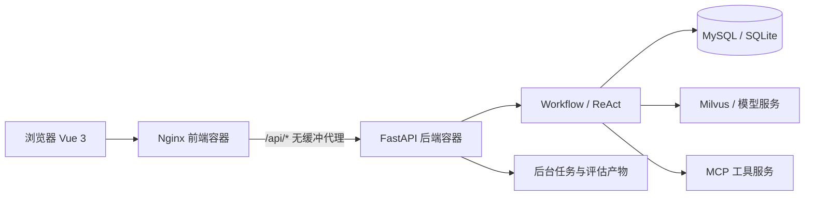

<!-- 本文定义 SHAF 前后端分离改造的范围、接口约束、分阶段交付与验收方式；源码核对发现的新约束须同步更新。 -->
# SHAF 前后端分离改造规划书

## 1. 目标与当前状态

本阶段将 FastAPI 直接提供的原生 HTML 页面迁移为独立 Vue 3 应用。以业务正确性、页面呈现及交互一致性为验收基准；保留已有混合 Workflow / ReAct 架构和数据流。最终部署边界为 Nginx 提供 Vue 构建产物并代理 API，独立 Python 容器运行 FastAPI。

**状态：十二个页面迁移、纯 API 切换及架构手册已完成。** 本文保留实施前的核心规划和各阶段记录；最终验证见第 9 节末尾。基线提交为 `faf161f`，远端为私有仓库 `UpliftingSoul/SHAF`。所有阶段提交统一以“前后端分离改造阶段：”开头。

### 1.1 已落实的前置工作

- 初始化 Git，保留现有源码、测试、知识材料与历史设计文档。
- README 更新框架正式名称与简介；`Introduction.txt`、本地环境和前端构建产物不入库。
- 建立源码基线并推送私有 GitHub 仓库。
- 安装 uv；使用项目 `.venv` 隔离调试依赖，不修改 conda 环境。

### 1.2 已确认的运行范围

用户已确认：所有服务以容器形式部署到 Ubuntu 云服务器，本地仅执行开发工作。本阶段保留 `make`、Bash、POSIX 进程组的 Linux 后台运行要求，不扩展原生 Windows 任务支持。本地缺少 Milvus、Linux 工具或其他必要服务的测试明确记为“因环境跳过”，不计为通过；仍执行可用的纯单元、模拟接口、前端构建与交互验证。容器内服务地址须可配置，不能继续假设各服务均位于同一进程环境的 localhost。

## 2. 源码事实与不可破坏的业务边界

### 2.1 主对话链路

`resolve_reference → classify_intent` 为入口，九种意图映射到五类处理路径：知识问题强制检索并经证据置信度、自检闸；退款路径先校验订单归属再检索政策；业务路径运行 ReAct；投诉及兜底路径提供固定话术。前端负责展示和提交用户选择，不承担意图分类、退款资格判断或工具权限决策。

完整 LangGraph 历史存于 SQLite checkpoint；MySQL 保存会话与消息审计。近期原文、较早半压缩消息和分段摘要共同组成模型上下文。迁移不得用浏览器历史代替服务端状态。

### 2.2 工具与用户确认

- 内置工具和 MCP 工具通过统一注册与执行引擎完成参数校验、权限、超时、重试及审计。
- 订单选择 interrupt 必须调用 resume 恢复原流程；普通建议动作中的订单选择则发送新的查单消息，两者不能混用。
- Agent 工单确认卡提交确认或取消；普通“建工单”按钮打开人工填写表单，沿用原有必填类别和描述。
- 退款建议仅生成表单草稿，用户选择固定原因后才由动作接口落库。模型自由文本不直接变成实际退款原因。
- 转人工仍为现有演示交互；不得把模拟行为描述成已接入真实客服系统。

### 2.3 知识与评估

MySQL 是知识原文权威源，Milvus 保存检索索引。双写先 pending 后向量化并标 done，失败时允许补写。挖知识暂存表的 kept 表示去重保留、待人审，approved 才表示人工采纳入库。飞轮待审队列是另一条审核流程，不能合并其状态语义。

成本、检索和分类器报表沿用脚本产物；评估趋势读取 `eval_runs`。前端仅做展示需要的格式化、比例绘图与同批结果比较，不重新实现指标算法。缺产物、失败、真实零值、未检索和检索零命中必须区分。

## 3. 目标架构

### 3.1 开发与生产请求路径

开发时 Vite 提供页面，将 `/api` 代理到 FastAPI，浏览器沿用相对路径请求。生产时 Nginx 提供静态构建产物并将 `/api` 代理到后端服务名，SPA 路由使用 history fallback。API 和健康检查路径不得误落到 `index.html`。

FastAPI 移除页面路由和静态资源挂载，保留业务 API 与 OpenAPI。显式配置开发环境所需 CORS 来源，禁止将带凭据的通配来源作为默认值。模型密钥、数据库密码、MCP 配置只留在后端；前端环境变量只能包含公开的连接配置。

### 3.2 技术与职责划分

- Vue 3、TypeScript、Vite、Vue Router；统一使用 Composition API 和 `<script setup lang="ts">`。
- 路由视图组合业务区块，区块使用明确的 props / emits，不形成新的巨大单文件。
- API 层统一 JSON 请求、校验错误与服务错误的展示。独立 SSE 层负责分帧和取消，不将解析器塞入聊天视图。
- composables 管理会话流、请求状态、后台任务轮询、分页与弹窗业务状态；组件负责呈现。
- 共享组件覆盖后台导航、面板、状态徽标、空态、提示、作业控制和日志。业务表格与图表保留独立语义，不建立难以理解的万能配置渲染器。
- 基础色彩、字体、边框、阴影与布局抽为共享样式；页面特有样式限制在组件内，避免后台 CSS 污染聊天页面。
- Markdown 渲染输出必须经过安全处理，引用编号与来源数据严格对应；不直接插入模型、用户或报表中的未经处理的 HTML。

新建源码文件包含头部职责说明，内部按状态、派生数据、请求、事件及生命周期划分注释。注释解释业务约束与边界，避免逐句翻译显而易见的代码。

## 4. 页面迁移与验收清单

保留现有十二条页面路径，Vue Router 支持直接访问、刷新及浏览器前进后退。

| 路径 | 视图职责 | 必须保留的交互 |
| --- | --- | --- |
| `/` | 聊天 | 新会话、历史切换、建议问题、输入框高度、回车发送、流式回复、工具提示、引用浮层、反馈、动作表单、interrupt 续跑 |
| `/admin` | 后台入口 | 业务模块入口及服务状态 |
| `/kb` | 知识录入 | 手工切块预览、来源预览、查重状态、人工采纳/弃用、向量化补写、四策略检索、最近知识块、作业日志 |
| `/rag-eval` | RAG 评估 | 指标切换、分桶柱图、生成质量、拒答个案、跨轮编造台账、筛选分页、处置说明及证据展开 |
| `/review` | 飞轮审核 | 状态筛选、频次排序、原话与召回快照展开、编辑核准答案、通过写库、驳回 |
| `/observability` | 观测与成本 | 意图成本、趋势涨跌、阈值分布和扫描图、独立缺失/错误状态、重跑 |
| `/topics` | 主题分布 | 类目计数、比例条、重点类目、摘要、归类任务 |
| `/topics/questions` | 主题问题 | URL 类目/页码、分页、类目切换、问题详情 |
| `/acceptance` | 分类器验收总览 | 九项闸门、在线状态、详情跳转、任务启动与停止 |
| `/acceptance/eval` | 分类器评测 | micro/macro、每类红线、阈值扫描、混淆矩阵、单句多标签试分类 |
| `/acceptance/data` | 分类器产物 | 语料血缘、数据集分布、泄漏自检、训练三件套、ONNX 一致性与作业 |
| `/acceptance/errors` | 分类器错例 | 错误类型记账、边界配对、逐条标准/预测对照及重跑 |

样式基线沿用奶油底色、像素猫、橙色强调、深色粗边框、阴影和字体，不进行视觉重新设计。检查桌面和窄屏布局、表格横向滚动、弹窗、长中文与空数据。必要的微小差异登记在验收记录中。

## 5. 接口与异步状态约束

### 5.1 SSE 协议

继续使用 POST 流式接口和既有 delta / tool / citations / actions / interrupt / done 帧。`[DONE]` 仅表示传输结束；interrupt 不等于一次业务已完成。会话 id 按后端返回同步保存，不能等到普通 done 才处理 interrupt 的会话归属。

解析器处理 UTF-8 跨分块、换行边界、CRLF、连续帧、最后残留数据和后端错误；每次发送、续跑和切换会话都有明确状态。路由离开或切换历史时取消旧请求，旧流不能写入新会话视图。后端已发现异常 SSE 分支对异步生成器使用同步遍历，实施时修复并验证错误帧。

### 5.2 会话持久化

保留浏览器中的 `mewhelp_session_id` 和 `mewhelp_conversation_id` 键，避免仅因重命名导致现有用户身份丢失。浏览器存储与站点来源绑定；独立前端换端口时不能自动读取旧来源存储，开发说明须解释这一边界，生产推荐同域代理。

### 5.3 后台任务与表单

后台作业保留服务端白名单、重任务确认、运行状态、停止、日志和完成后刷新。轮询在组件卸载时停止，错误后可重试，不允许生成多个重复定时器。任务结束与页面数据刷新分别管理，刷新失败不能把已完成任务改成失败。

预览输入或内容类型变化时使旧预览失效，避免按旧块数确认新正文。表单提交防重复，失败时保留用户输入；列表刷新和弹窗关闭不能让过期响应覆盖新状态。分页沿用服务端裁剪后的页码。

## 6. 分阶段实施与 Git 检查点

1. **源码核对与规划定稿**：完整阅读未核对源码、脚本和测试；建立页面、接口、状态映射；明确平台选择与测试依赖，提交规划。
2. **前端基础与后端边界**：创建 Vue 工程、路由、共享基础组件、API/SSE 层；增加后端来源配置与健康检查，保留原页面直到迁移验证完成。独立提交。
3. **聊天迁移**：实现会话与流式状态、消息呈现、引用、反馈、动作和续跑；优先验证有状态交互与失败路径。独立提交。
4. **知识与审核迁移**：实现知识录入、检索、暂存审核和飞轮审核；核对 pending / kept / approved 等状态。独立提交。
5. **评估与分类器后台迁移**：迁移 RAG、观测、主题、四个验收页面；复用作业组件与图表呈现，验证所有交互。可按模块拆分提交。
6. **切换与部署边界**：确认十二条路由完成后移除旧静态前端及 FastAPI 页面路由，更新启动说明，准备符合双容器边界的 Nginx 和镜像配置。独立提交。
7. **手册与最终验收**：逐文件架构手册、文件覆盖检查、最终回归记录；提交并推送已验证版本。

每次提交前检查 diff、源码编译和适用验证；不把依赖安装产物、临时日志、密钥和训练大文件提交。旧前端的完整回溯由基线 Git 提供，最终目录不保留重复运行入口。

## 7. 验证策略

- **后端基线**：区分纯单元、模拟接口、真实 MySQL 与外部服务测试。真实数据库测试只能指向独立测试库，不对业务库执行测试夹具的删表重建。
- **前端静态验证**：类型检查、生产构建、路由完整性和安全渲染。
- **关键单元验证**：SSE 分帧、interrupt 与完成状态、取消和会话隔离、API 错误转换、预览失效、任务轮询生命周期。避免只复述实现的测试。
- **浏览器交互验证**：使用受控 API 数据覆盖十二个页面，包括空态、错误态、正常态，以及表单、分页、图表切换、确认与取消。受控数据仅用于测试，不能替代生产 API。
- **真实联调**：在依赖和平台可用时连接 MySQL、Milvus、MCP 与模型服务验证主链路；真实调用会产生模型费用，运行范围须明确。测试记录区分实际服务与受控接口，不能将模拟通过写成真实全链路通过。
- **视觉检查**：同尺寸旧/新页面比较，重点检查聊天、知识表单、审核弹窗、RAG 图表及窄屏。必要差异说明原因，不以代码简化为理由取消功能。

## 8. 文档交付与文件覆盖标准

最终 `docs/architecture.md` 按前端、后端、脚本、测试、SQL、知识/数据、部署与配置、历史设计文档分层，逐文件列出职责和关键依赖。正式文件全集以 Git 跟踪文件与本阶段待提交文件为依据，校验遗漏、重复及已删除文件的过期说明。

本地忽略文件单列目录规则与作用，如 `.venv`、`node_modules`、`.env`、`Introduction.txt`、checkpoint、日志和训练产物；不逐个列出第三方依赖内部文件，也不暴露秘钥内容。手册明确历史设计文档仅为背景、源码与本阶段规划优先。

README 更新开发入口与功能导航；部署文档本阶段只保留双容器边界初稿和基础设施、初始化、后台任务环境及持久化要点。用户已明确正式部署手册属于后续阶段，因此不继续扩展云服务器部署实现；原手册可从基线 Git 完整恢复。最终交付包含实际开发步骤、已执行验证结果及尚需环境支持的验证项。

## 9. 当前验证记录

2026-09-30：按 `uv.lock` 安装 Python 3.12 主应用和开发依赖成功。基线中上下文分层、模型预算保护、稳定提示词前缀、知识切块、证据置信度、意图路由及分类阈值的十组测试文件共 **75 项通过**。测试使用临时进程环境中的占位模型配置，不建立真实模型请求、不重建业务数据库。这是已覆盖部分的基线记录，不代表全部后端或真实链路已验证。

### 第一批迁移检查点

- 已建立独立 `frontend/`（Vue 3、TypeScript、Vue Router、Vite），迁移聊天、知识录入和飞轮待审三个页面；剩余九页继续分阶段实施。此时旧 FastAPI 页面入口仍保留，完成全部页面后再切换。
- 后端只增加明确来源的 CORS、`/api/health` 存活检查、分类器可配置地址，并修复 `/api/chat` 错误帧中的异步生成器遍历 bug；图编排、检索、记忆、工具和数据规则保持原实现。
- 第一批前端类型检查及生产构建通过；九项单元回归通过（SSE 分块/断流/错误、会话隔离、取消建单、历史重试、渲染消毒与引用）。浏览器受控接口测试覆盖流式聊天、反馈、工单取消及切块预览失效。
- 原九组接口测试由基线 **40 通过、3 失败**变为全部 **43 通过**；新增 API 边界两项通过。审核接口的六项真实 MySQL 测试尝试时因当前测试库凭据不可用（认证拒绝）无法建立夹具，后续按用户已确认范围跳过；不计入通过项。没有修改数据库凭据或执行成功的测试库重建。
- 开发采用 Vite `/api` 代理；生产采用 Nginx 同域代理和 SPA 路由回退，依据 [Vue 工具链指南](https://vuejs.org/guide/scaling-up/tooling.html)、[Vite 代理配置](https://vite.dev/config/server-options.html)和 [Vue Router history 部署说明](https://router.vuejs.org/guide/essentials/history-mode.html)核对。

### 全页面迁移检查点

- 十二个页面均已迁移为 Composition API + TypeScript；提取报表、图表、台账、作业、文件清单和分页组件，并统一格式化，提高源码可读性。
- 前端单元测试 **12 项通过**；受控浏览器回归 **5 项通过**，覆盖聊天、知识预览、审核、后台首页、主题分页、观测、四张分类验收页面及 RAG 台账。另 **1 项仓库真实报告展示测试通过**，不连接真实数据库或模型；缺值与报告齐全两种状态分别验证。
- 截图校验修正聊天根容器选择器，恢复桌面居中和网格背景；窄屏验证隐藏侧栏且聊天框占满视口。分类扫描产物实际字段 `in_use` 与旧页面字段不一致，在视图层兼容修正，保留在用阈值标记。
- 任务轮询测试验证串行请求、失败后续查、卸载取消和重任务取消确认。RAG 处置写回失败保留人工说明，可再次提交；本轮幻觉率与跨轮累计台账保持不同口径。
- 本检查点仍保留旧页面文件作为切换前参照；下一步移除 FastAPI 页面与静态挂载，以 Vue 路由和 Nginx 承担页面服务。

### 最终切换与验收记录

2026-09-30：十二个 Vue 页面完成切换；删除十五个旧静态页面/共享资源文件及 FastAPI 页面路由、静态挂载。后端保留业务 API、OpenAPI 和健康检查，旧页面可从基线提交恢复。已有图、检索、记忆和工具业务没有改写。

| 验证 | 实际结果与边界 |
| --- | --- |
| 后端受控接口回归 | **47 项通过**：聊天、Agent、动作、退款、会话、反馈、作业、RAG、提取、CORS/API 边界和纯 API 切换；使用模拟依赖，不代表真实数据库与模型联调 |
| 前端单元测试 | **12 项通过**：SSE 分块/错误、会话隔离、确认取消、历史重试、内容消毒/引用及作业轮询生命周期 |
| 浏览器回归 | **7 项通过**：十二页、聊天续跑与反馈、知识预览失效、审核失败重试、类目分页、报告缺值/齐全、台账处置重试，以及选单续跑后的退款原因校验和失败重试 |
| 类型与生产构建 | `npm run build` 通过，包括 `vue-tsc --noEmit` 与 Vite 生产构建 |
| 格式与差异检查 | `npm run format:check`、`git diff --check` 通过 |
| 文件覆盖 | `python scripts/check_architecture.py`：**361/361（100%）**，无遗漏、重复或过期条目；忽略的依赖/本地配置/运行数据按目录规则另述 |
| 视觉检查 | 聊天桌面居中、窄屏侧栏隐藏；知识、审核、RAG、分类评测截图及真实仓库报告展示已检查 |
| 未执行的环境验证 | 真实 MySQL 夹具因凭据不可用跳过；Milvus、完整模型/MCP 链路、Linux 任务及 Docker/Nginx 容器联调未执行，不计为通过 |

必要差异：保留原浏览器身份键和界面主题；明确区分缺报告/缺值/取数失败与真实零值；知识 `kept` 按后端实际语义显示为待审；修正分类阈值产物 `in_use` 的兼容读取。订单、物流 mock 和转人工演示仍沿用原项目定位。

部署文件仅提供后续双容器设计所需的初稿与边界说明。原 Linux 作业中依赖 Docker CLI、同环境分类器进程或 ML 重依赖的目标，需要后续部署阶段对接云端服务容器，当前不宣称已完成云部署或全部真实服务验收。
